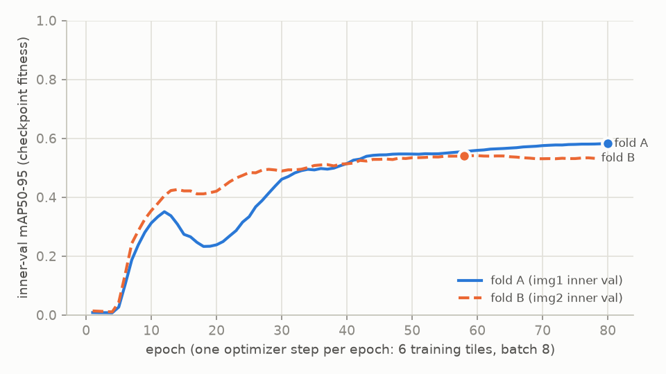
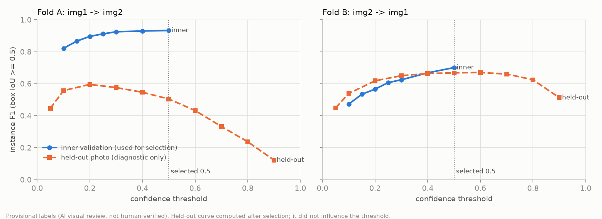
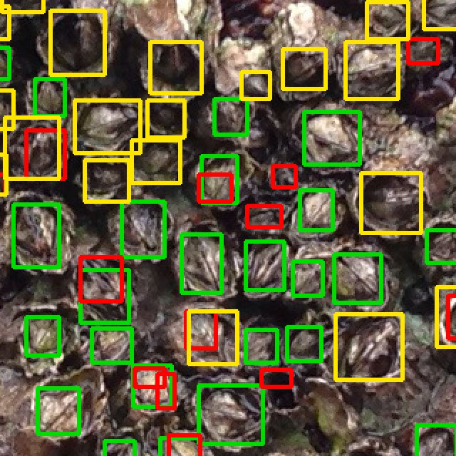
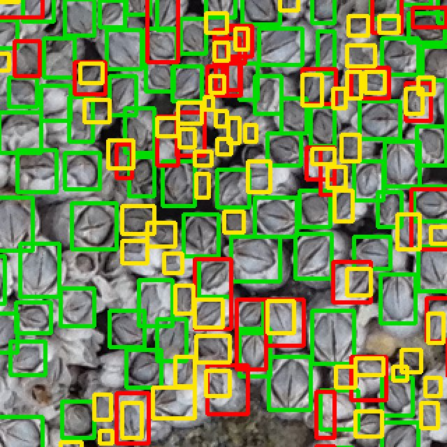
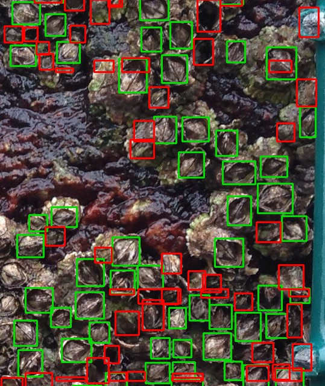

# Barnacle counting prototype: final evaluation report

*Generated by `python -m barnacles report` from recorded run outputs (`runs/`, `data/manifests/`,
`reports/tests/`). Every number below is filled from those files. The interpretive text was written
for these recorded runs. Primary experiment: `yolo11n_tile640_v1`.*

## 0. Read this first: what kind of evidence this is

| Evidence tier | What it covers in this report |
|---|---|
| **Measured against provisional labels** | All counts, precision, recall and F1 on img1/img2. The reference labels come from the supplied contour masks after an **AI visual review** (status `ai_visual_inspection_provisional`). No person has verified them. |
| **Computational measurement** | Training time and inference latency on the recorded machine (NVIDIA GeForce RTX 4060 Laptop GPU, torch 2.11.0+cu128, ultralytics 8.4.182). |
| **Demonstration only (no reference)** | Detections on `unseen_img1.png` and `unseen_img2.png` from the final train-all model. |

All sizes are in **image pixels**. No physical size (mm) is claimed: the frame and ruler were not
used for calibration. With only two labeled photographs there is no untouched test set. Each fold
tests transfer to one other scene, so no confidence intervals are reported.

## 1. Results at a glance

Proposed (aspirational) targets, per fold: count error ≤ 10 % and instance F1 ≥ 0.80, both at once.
**Targets met: fold A — no; fold B — no.**

| Fold | Train → held-out | Reference count N | Predicted P | P − N | abs % error | TP / FP / FN | Precision | Recall | F1 (box IoU ≥ 0.5) | F1 (centre match) |
|---|---|---|---|---|---|---|---|---|---|---|
| A | img1 → img2 | 397 | 213 | -184 | 46.3 % | 154 / 59 / 243 | 0.723 | 0.388 | 0.505 | 0.607 |
| B | img2 → img1 | 1732 | 1464 | -268 | 15.5 % | 1068 / 396 / 664 | 0.730 | 0.617 | 0.668 | 0.782 |

Aggregates: the macro mean absolute count error is 226.0 targets
(30.9 % mean absolute percentage error). The micro-pooled
detection scores are TP/FP/FN 1222/455/907, precision
0.729, recall 0.574 and F1 0.642. The two folds differ
so much in density that the per-fold rows are the meaningful ones.

Both thresholds were chosen on inner validation only: 0.500 for fold A and 0.500 for
fold B. Both are the **maximum of the pre-set grid (0.10–0.50)**, and inner F1 was still
rising there. The grid limit, not the data, set the threshold, and the final model inherits it. The machine-readable rows are in [`results.csv`](results.csv).

## 2. What was built

* **Labels:** contour-mask components became candidates. Flagged candidates were reviewed and
  corrected through explicit, replayable operations (splits of touching outlines, deletion of 1–4 px
  stray pixels). Only flagged candidates were inspected one by one. The unflagged single-ring
  candidates were accepted after a tile-level survey, and keep the status `unreviewed_candidate` in
  the annotation files. This turned 1747 / 521 candidates into
  1732 / 397 objects (img1 / img2). The provenance is AI visual
  inspection, so the labels are provisional.
* **Model:** YOLO11n, COCO-pretrained, fine-tuned as one class on native-resolution 640 px tiles
  (stride 512). The ROI is grey-masked outside the frame polygon. Mosaic is disabled. AdamW with
  lr0 1e-4, an 80-epoch budget (patience 20) and batch 8.
* **Inference:** tiles → per-tile NMS → coordinate restoration → one global NMS (IoU 0.5) →
  centre-in-polygon count. One code path serves evaluation, prediction and benchmarking.
* **Checks before training:**
  * Offline CPU unit and integration tests: 149 of 149
    passed (0 failures, 0 errors). They cover geometry,
    mask parsing, clipping, merging, matching, a dense synthetic scene of 4,225 objects and inference
    isolation.
  * The GPU training round trip: 1 of 1 passed.
  * A 1-epoch smoke test (passed: yes).
  * An overfit diagnostic (passed: yes). On 4 training tiles, F1 rose
    from 0.000 to 0.981 within 200 updates. The labels,
    scaling and pretrained loading therefore work.

Training facts per fold:

| Fold | training tiles / objects | epochs run | optimizer steps (applied; AMP-skipped) | best epoch | inner-val mAP50-95 | inner-val F1 at selected conf (P / R) | inner refs | train time |
|---|---|---|---|---|---|---|---|---|
| A | 6 / 1090 | 80 | 80 (76; 4) | 80 | 0.582 | 0.933 (0.948 / 0.919) | 555 | 114.7 s |
| B | 6 / 231 | 78 | 78 (74; 4) | 58 | 0.541 | 0.701 (0.549 / 0.970) | 133 | 107.6 s |

Fold A's best epoch was 80 of 80, so it was still improving slowly at the
budget. Fold B's was 58 of 78. Each epoch is a single optimizer step on six
tiles, so the budget is small: 80 and 78 updates. This was not tuned, because tuning on img1's inner validation would leak into fold B,
whose held-out photo is img1.

## 3. Does the approach transfer between the two scenes?

**Only partially.**

* **Fold A** transferred poorly. Its inner-validation F1 was 0.933 (same photo, different
  region), but its held-out F1 was 0.505.
* **Fold B** was already weak inside its own photo. Its inner precision was only
  0.549 (106 unmatched detections among 133 references; see
  section 4). Held-out F1 was 0.668, against inner F1 0.701.

At the selected thresholds, both held-out photos are under-counted: P − N is
-184 (A) and -268 (B).

The held-out curves (orange, computed **after** selection and never used to choose anything) show
the threshold is not the main problem:

* Fold A's best possible held-out F1 on the diagnostic grid is 0.596 (at
  0.200).
* Fold B's is 0.670 (at 0.600).

Neither reaches 0.80 at any threshold on that grid. The exploratory gains in section 7 come from a
single seed per fold; seed variance was not measured. Score calibration also shifts between scenes:

* At the fixed sensitivity setting of 0.25, fold A's count error falls to
  -16 (4.0 %), with F1 0.586.
* Fold B then over-counts by 250 (14.4 %).

A good count at some threshold can hide offsetting misses and false positives.

## 4. Which errors dominate?

1. **Scale and appearance shift between the photos.** Size bins were fixed from each fold's
   training labels before testing (√(box area)).
   * Fold A was trained on img1, whose small/large thresholds are 18.4 px and
     24.0 px. In img2, 395 of 397 references fall in the top third of
     img1's training sizes (the "large" bin, ≥ 24.0 px). Their recall is
     0.390.
   * Fold B was trained on img2, with thresholds 35.8 px and 42.3 px.
     In img1, 1717 of 1732 references fall in its "small" bin, with recall
     0.613.
   * Each model is being asked to find barnacles at a scale it has barely seen.
   * The inference-only **single resized pass** ablation backs this up. Fold A *improves* to F1
     0.587 when img2 is shrunk to 0.4×, because its large targets then match
     img1's training size. Fold B collapses to F1 0.007 because img1's small targets
     shrink further.
   * See [`figures/fold_A_heldout_overlay.jpg`](figures/fold_A_heldout_overlay.jpg): yellow = missed
     reference, red = false positive, green = matched.

    

   *Held-out dense zooms at 2×. Left: fold A on img2, where large barnacles are missed (yellow).
   Right: fold B on img1, with small openings missed and mis-sized boxes (red/yellow pairs).*
2. **Box size, not just presence.** Centre matching scores well above IoU ≥ 0.5 matching:
   * Fold A: centre-match F1 0.607 against box F1 0.505.
   * Fold B: 0.782 against 0.668.
   * Many detections land on a real barnacle but with a box of the training scene's size (fold B
     draws large boxes on img1's small openings, visible as red/yellow pairs in
     [`figures/fold_B_zoom_dense.jpg`](figures/fold_B_zoom_dense.jpg)).
3. **Ring-like and dark structures that the labels do not mark.**
   * Inside img2 itself (fold B inner validation, development photo only), many unmatched detections
     sit on **empty shells** (hollow, dark centre). The inferred convention leaves these unlabeled.
     Others sit on the frame wire or its twist tie at the ROI edge, and on dark gaps between shells.
     See `figures/fold_B_inner_val_errors.jpg`, below.
   * On img1 the same model also fires on seaweed and deep shadow
     ([`figures/fold_B_zoom_dark.jpg`](figures/fold_B_zoom_dark.jpg)). img2 has almost no seaweed.
   * The account owner confirmed that empty shells are **not** counted, so these are genuine false
     positives under the agreed convention.
   * The share of false positives in each category was **not measured**.

   

   *Green = matched, red = unmatched detection, yellow = missed reference.*
4. **Not dominant:**
   * Tile seams: recall near seams 0.432 / 0.614 against interior
     0.369 / 0.618.
   * ROI boundary: F1 on the region eroded by 32 px is 0.514 / 0.670, against
     0.505 / 0.668 on the full region.
   * Detection caps: no tile hit `max_det`.

## 5. Does tiling preserve small-target recall? Does overlap help, and at what cost?

* **Tiling versus one resized pass:** on img1 (fold B), where 1717 of 1732
  references are in the small bin, the tiled pipeline reached overall recall 0.617, while a
  single 640 px pass reached 0.003. Native-resolution
  tiling is necessary for small barnacles. For img2's large targets (fold A), resizing happened to
  help, but only because it undid the scale mismatch. That is not a reason to drop tiling.
* **Overlap (stride 512) versus no overlap (stride 640, padded last tile), same checkpoint and
  threshold:**
  * Fold A: F1 0.505 with overlap against 0.425 without.
  * Fold B: 0.668 against 0.655.
  * Tile counts are 9 with overlap and 9 without (A),
    and 9 and 9 (B), so overlap costs nothing extra on
    these ROIs.
* **Duplicate merging:**
  * Raw tile detections at the selected threshold: 276 (A) and
    2410 (B). After global NMS: 213 and 1464.
  * Counted detections that touch an interior tile edge, possible seam duplicates: 9
    (A) and 105 (B).
  * A heavily truncated fragment (IoU < 0.5 with the full box) cannot be merged by IoU-NMS. This is
    a known, tested limitation.
  * Seam precision is lower than interior precision in fold B (0.639 against
    0.778).

## 6. Measured latency (complete image: disk load → ROI → all tiles → merge → count)

Three warm-up runs, then ten timed runs. File writing and model loading are excluded. Fold A's
held-out image is img2; fold B's is img1.

| Setting | Fold A median / p90 (ms) | Fold B median / p90 (ms) |
|---|---|---|
| GPU, tiled | 363.8 / 526.6 | 754.8 / 808.4 |
| GPU, single resized pass | 454.3 / 465.7 | 643.0 / 662.9 |
| CPU, tiled | 847.1 / 865.1 | 1069.4 / 1095.4 |
| CPU, single resized pass | 510.3 / 543.3 | 650.9 / 676.0 |

* **Where the time goes:** on the GPU the 9-tile network inference takes only
  68.8 ms (A) and 123.7 ms (B). Most of the latency is PNG decoding
  plus ROI preparation: 281.2 ms and 578.6 ms.
* **Memory:** peak CUDA memory was 231.0 MiB / 240.9 MiB.
* **Other costs:** model load took 0.160 s, and writing the overlay JPEG took
  about 0.259 s.
* **An optimization that changed no output:** an earlier implementation spent
  2879.3 / 2461.1 ms per image on load plus polygon
  rasterisation. It was replaced by a scanline version that produces identical
  support masks and identical predictions. Those first timings are kept as
  `benchmark_v0_slow_rasterizer.json`.

The provisional engineering target of under 5 s per framed image is met on this GPU and also on
the CPU. No human timing study was run, so no "minutes saved" figure is claimed.

## 7. Exploratory follow-up (held-out-informed; NOT an untouched test)

The diagnostics above pointed to scale shift, so **one** bounded follow-up was run after the
held-out results were seen: experiment `yolo11n_tile640_scaleaug_exploratory` (`configs/exploratory_scale_aug.yaml`). It is
identical to the primary recipe except that the random scale augmentation is widened from ±10 % to
±50 % (`scale: 0.50`). The splits, threshold-selection rule, evaluation code and annotations are
the same.

**Status: exploratory.** The change was chosen because of what the held-out photos showed. These
numbers are therefore *not* an untouched test and do not replace section 1.

| Fold | Count N / P (P − N, abs %) | TP / FP / FN | Precision | Recall | F1 (box) | F1 (centre) | selected conf | meets targets |
|---|---|---|---|---|---|---|---|---|
| A, primary | 397 / 213 (-184, 46.3 %) | 154 / 59 / 243 | 0.723 | 0.388 | 0.505 | 0.607 | 0.500 | no |
| A, exploratory | 397 / 469 (72, 18.1 %) | 280 / 189 / 117 | 0.597 | 0.705 | 0.647 | 0.709 | 0.500 | no |
| B, primary | 1732 / 1464 (-268, 15.5 %) | 1068 / 396 / 664 | 0.730 | 0.617 | 0.668 | 0.782 | 0.500 | no |
| B, exploratory | 1732 / 1658 (-74, 4.3 %) | 1206 / 452 / 526 | 0.727 | 0.696 | 0.712 | 0.824 | 0.500 | no |

What it shows:

* **Recall on the out-of-scale targets rose.**
  * Fold A's recall on img2's "large" targets went from 0.390 to
    0.706.
  * Fold B's recall on img1's "small" targets went from 0.613 to
    0.694.
  * Both folds' F1 improved, which supports scale shift as a dominant error mechanism.
* **Precision fell in fold A** (0.723 → 0.597). The fold A model now
  over-counts img2 by 72 (18.1 %). Fold B's count error is
  4.3 %, but its F1 is still 0.712, below 0.80.
* **A small count error is not enough.** Fold B's count lands within 10 %, but
  452 false positives and 526 misses offset each other. Both targets would have to
  hold together.
* **Inner validation barely moved.** Fold A inner F1 went from 0.933 to 0.943,
  and fold B's from 0.701 to 0.730. Within-photo validation could not have
  revealed this transfer gain. This is exactly why two photos are a weak basis for model selection.
* **Threshold at the grid edge again.** The inner threshold again hit the top of the fixed grid
  (0.500 and 0.500).

The honest reading is that stronger scale augmentation is a promising direction to test on **new**
labeled scenes. It is not a validated improvement.

## 8. Final train-all model (demonstration only)

* **Training:** after the outer-fold results were frozen, YOLO11n was retrained from the original
  COCO weights on all reviewed tiles of both photos. It ran for 69 epochs with no
  early stopping and uses `last.pt` (sha256 prefix `71eb2a91d2a6`).
* **Epoch rule:** 69 is the round-half-up median of the two folds' best epochs.
* **Caveat on that rule:** with 18 tiles this meant 207 optimizer steps
  (202 applied), 2.620× a fold model's. An epoch count does not preserve
  the number of updates.
* **Deployment confidence:** 0.500, the median of the two inner-selected thresholds. This
  is a provisional heuristic, since refitting changes score calibration.

| Image | Region | Detections counted (confidence ≥ 0.500) |
|---|---|---|
| unseen_img1.png | inner-frame polygon (AI-proposed) | 1189 |
| unseen_img2.png | whole 500×500 close-up (no frame; no area implied) | 133 |

These counts have **no reference labels** and are not accuracy measurements. Overlays:
[`figures/unseen_img1_demo_overlay.jpg`](figures/unseen_img1_demo_overlay.jpg) and
[`figures/unseen_img2_demo_overlay.jpg`](figures/unseen_img2_demo_overlay.jpg). Green marks the
counted detections; orange marks lower-score candidates for a person to check. Scores of this model
on img1/img2 would be resubstitution, not test results, and are not reported.

## 9. What a person would still need to correct

On a scene like the held-out ones, a reviewer working from the overlay would need to:

* add the missed barnacles: 243 of 397 in img2 (fold A) and 664 of
  1732 in img1 (fold B);
* delete the false positives: 59 and 396 respectively. They include empty shells,
  seaweed or shadow, and mis-sized boxes on real barnacles. The proportions were not measured.

That is too many corrections to call the counts automatic. Two things would make correction faster
than counting from scratch:

* The overlays put every candidate in its own box, and lower-score candidates are shown in a
  separate colour.
* Errors cluster by scene type and size, so a reviewer can sweep region by region.

Whether it is actually faster was **not measured**.

## 10. What would most improve confidence

1. **More labeled scenes**, with different barnacle sizes, rock colours, lighting and algae. The
   dominant error is scene and scale shift. Two photos cannot show whether a model generalizes,
   and more epochs on the same two would not answer that.
2. **A human check of the labels and frame polygons**, especially the ambiguous cases listed in `data/annotations/corrections/*_corrections.json`, and the targets
   partly under the wire. Until then all scores stay provisional.
3. **Scale robustness:**
   * Training with stronger scale augmentation (see section 7) or on mixed-scale tiles.
   * Optionally, normalising image scale using the fixed frame size before tiling.
   * Both must be evaluated on scenes that did not motivate them.
4. **A timed human-in-the-loop study:** manual counting against correcting the model's overlay on
   the same regions. Only that study can support a claim about saving time.

## 11. Reproducibility and provenance

* **Environment and sources:** `data/manifests/environment.json`, `requirements-lock.txt`,
  `data/manifests/source_hashes.json` (raw PNGs, never modified) and `data/manifests/weights.json`
  (official `yolo11n.pt`, v8.4.0 asset).
* **Splits and tiles:** `data/manifests/fold_*/split_manifest.json`. These contain the exact split
  geometry, excluded gap objects, support-mask hashes, tile records and the size bins fixed before
  testing.
* **Per run:**
  * `run_record.json`: resolved arguments, optimizer steps, AMP-skipped steps, the best-epoch
    cross-check and checkpoint hashes.
  * `threshold_selection.json` and `threshold_sweep.csv`.
  * `evaluation/`: metrics, original-coordinate predictions, `matches.csv`, overlays and zooms.
  * `ablations.json` and `benchmark.json`.
* **Freeze record:** code, config and annotation hashes before held-out scoring are in
  `runs/yolo11n_tile640_v1/frozen_before_heldout.sha256`.

## 12. Code changes made after the pre-evaluation freeze record

`frozen_before_heldout.sha256` no longer verifies for three files. They changed after the held-out
evaluation, for reasons that do not touch the scored outputs:

* `geometry.py`: the polygon rasterizer was rewritten for speed (section 6). Split support-mask
  hashes still equal the frozen manifests. Re-running held-out inference gave the same counts
  (213 / 1464) and the same boxes; that check was done in-session and was not saved as a file.
* `predict.py`: the redundant `half=False` keyword was removed (it only produced a deprecation
  warning), and the `predict` command for the unseen demonstrations was added.
* `evaluate.py`: `inner_val_overlay` was added for the report figure. `report` asserts that it
  reproduces the recorded inner-validation TP/FP/FN.

No threshold, checkpoint, annotation or metric definition changed after the held-out results were
seen. Two safeguards are not yet enforced by code (known gaps):

* `evaluate` does not compare the config and split-manifest hashes against the run record.
* `build-dataset` does not refuse annotations that failed validation.

A later text-only edit changed the reviewer-name wording in the annotation, correction and ROI files
and a config header comment. The old and new file hashes, and the field-by-field check that labels,
polygons and settings are unchanged, are recorded in `data/manifests/provenance_text_edit.json`.
Run records written before that edit store the old hashes.
